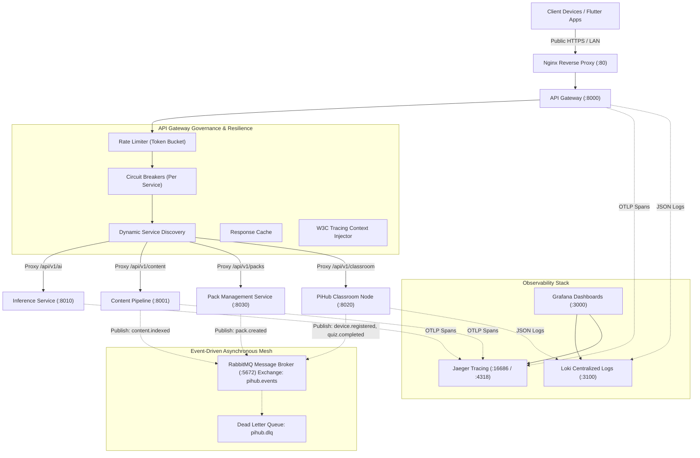
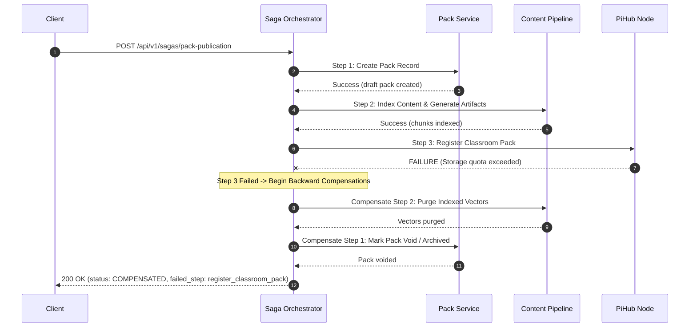

# PIHUB Microservices Architecture (MSA) Specification & Guide

This document specifies the microservices architecture implementation for the **PIHUB Distributed Educational AI Ecosystem**. It covers the 10 core additions designed to evolve PIHUB into a resilient, observable, event-driven, and fault-tolerant distributed system.

---

## 1. Summary of Architectural Additions

| # | Addition | Priority | Architectural Pattern | Primary Purpose |
|---|----------|----------|-----------------------|-----------------|
| 1 | **RabbitMQ Event Bus** | Essential | Event-Driven Architecture | Asynchronous event publishing, decoupling, and durable message queuing |
| 2 | **Transactional Outbox & Idempotent Consumer** | Essential | Outbox & Idempotency Patterns | Atomic local state persistence + event publishing with duplicate protection |
| 3 | **Dynamic Service Discovery** | Essential | Dynamic Registry & Client-Side Load Balancing | Multi-instance dynamic address resolution and health-aware routing |
| 4 | **Circuit Breaker Pattern** | Essential | Fault Tolerance & Degradation | Per-service failure isolation (Closed/Open/Half-Open) to prevent cascading crashes |
| 5 | **Centralized Structured Logging** | Essential | Distributed Observability | Standardized JSON log formatting with correlation IDs (`X-Request-ID`) |
| 6 | **API Gateway Improvements** | Essential | API Gateway Pattern | Rate limiting (Token Bucket), request validation, versioning (`/api/v1`), response caching |
| 7 | **Database per Service** | High | Data Independence & Bounded Contexts | Explicit domain data ownership and isolated operational SQLite databases |
| 8 | **Distributed Tracing (OpenTelemetry / Jaeger)** | High | Distributed Tracing & W3C TraceContext | End-to-end request latency profiling with `traceparent` propagation across microservices |
| 9 | **Inter-Service Zero-Trust Authentication** | High | Service-to-Service Security | Signed short-lived JWTs and role-based service permission enforcement |
| 10 | **Saga Pattern for Distributed Transactions** | Advanced | Orchestrated Saga with Backward Compensation | Multi-service transaction coordination with reverse compensating rollbacks |
| 11 | **Independent CI/CD Workflows** | Advanced | Independent Pipeline Automation | Path-triggered GitHub Actions workflows for isolated service builds and tests |

---

## 2. Distributed Architecture Overview



---

## 3. Detailed Additions & Implementation Details

### Addition 1: RabbitMQ Event Bus & Event-Driven Architecture
- **Exchange:** `pihub.events` (Topic exchange)
- **Dead-Letter Exchange:** `pihub.dlx` with queue `pihub.dlq`
- **Shared Envelope:** `backend/shared/events/schemas.py` defines standard `Event`:
  - `event_id`: Unique UUIDv4
  - `event_type`: Dot-notated domain event type
  - `timestamp`: UTC ISO 8601
  - `version`: Event version (default `1.0`)
  - `producer`: Service origin identifier
  - `correlation_id`: Correlation/Trace ID for request lineage
  - `payload`: Structured JSON payload
- **Event Catalog:**
  - `pack.created`: Pack Management Service $\rightarrow$ Content Pipeline, PiHub
  - `pack.updated`: Pack Management Service $\rightarrow$ PiHub, Analytics
  - `device.registered`: PiHub $\rightarrow$ Analytics, Classroom Intranet
  - `student.progress.updated`: PiHub $\rightarrow$ Analytics
  - `quiz.completed`: PiHub $\rightarrow$ Analytics
  - `content.indexed`: Content Pipeline $\rightarrow$ Pack Service, Analytics
  - `sync.completed`: PiHub $\rightarrow$ Analytics

### Addition 2: Transactional Outbox Pattern & Idempotency
- **Location:** `backend/shared/events/outbox.py` & `backend/shared/events/consumer.py`
- **Transactional Outbox:** Staged in `outbox_events` in the service's operational database within the same transaction as business data. The background drain worker (`TransactionalOutbox.publish_pending`) guarantees at-least-once publishing even during broker restarts.
- **Idempotent Consumer:** Each consumer maintains a `processed_events` table indexed by `(event_id, consumer_id)`. Incoming messages with identical IDs are acknowledged and skipped.

### Addition 3: Dynamic Service Discovery & Load Balancing
- **Location:** `backend/shared/discovery/registry.py`
- **Capabilities:**
  - Dynamic registration via `POST /api/v1/discovery/register`
  - Active background heartbeat health probes (`/health`)
  - Load-balancing strategies: Round-Robin, Least-Connections, Random
  - Passive fault isolation: automatically removes unreachable instances on HTTP connection error.
  - Transparent fallback: defaults to container DNS if dynamic instances are not registered.

### Addition 4: Circuit Breaker Pattern
- **Location:** `backend/shared/resilience/circuit_breaker.py`
- **States:**
  - `CLOSED`: Normal traffic passed to downstream services.
  - `OPEN`: Failures exceed threshold (default 5). Calls fail fast with HTTP 503 or return a cached/degraded fallback payload without touching downstream workers.
  - `HALF-OPEN`: After recovery timeout (default 15s), a limited test capacity (1–2 calls) is admitted to verify service health before closing.
- **Per-Service Isolation:** Separate circuit breakers for `inference-service`, `content-pipeline`, `pack-service`, `pihub`, and `voice-service`.
- **Inspection:** `GET /api/v1/system/circuit-breakers` and `POST /api/v1/system/circuit-breakers/{service}/reset`.

### Addition 5: Centralized Structured JSON Logging
- **Location:** `backend/shared/logging/json_logger.py`
- **Output:** Every log line is formatted into single-line JSON:
  ```json
  {
    "timestamp": "2026-11-10T07:30:00.000Z",
    "service": "inference-service",
    "level": "INFO",
    "request_id": "req-9c3f1b0a8d2e",
    "trace_id": "8a7c2e4f01b9d4e56c128f7a93b4d5e6",
    "message": "POST /ai/tutor 200 (452.12ms)",
    "duration_ms": 452.12
  }
  ```
- **Loki & Grafana:** Container logs are ingested into Loki (`http://localhost:3100`) and queried in Grafana (`http://localhost:3000`).

### Addition 6: API Gateway Governance
- **Location:** `backend/gateway/app/main.py`
- **Rate Limiting:** `TokenBucket` algorithm with headers `X-RateLimit-Limit`, `X-RateLimit-Remaining`, and `Retry-After` on HTTP 429.
- **Versioned Routing:** Core APIs exposed under `/api/v1/...` alongside backwards-compatible legacy paths.
- **Response Caching:** In-memory LRU TTL response cache for read-only catalog endpoints.

### Addition 7: Database per Service
- **Location:** `backend/shared/db/ownership.py`
- **Data Ownership Matrix:**

| Service Domain | Isolated Datastore | Owned Business Entities |
|----------------|-------------------|--------------------------|
| **PiHub** | `pihub.sqlite3` | Classrooms, Devices, Students, Progress, Quizzes, Sync Queue |
| **Pack Service** | `pack_service.sqlite3` | Packs, Manifests, Versions, Compilations, Bundle Archives |
| **Content Pipeline** | `content_pipeline.sqlite3` + Mongo | Ingestion jobs, Document states, Chunk metadata, Media index |
| **Inference Service** | `inference_service.sqlite3` | Model configurations, Benchmark logs, Prompt cache statistics |
| **API Gateway** | `gateway_audit.sqlite3` | Client audit logs, Rate-limit persistence, Service mesh states |

- Enforces WAL (Write-Ahead Logging) for high concurrency and strict API/event-based data access across boundaries.

### Addition 8: Distributed Tracing with OpenTelemetry
- **Location:** `backend/shared/tracing/tracer.py`
- **Traceparent Standard:** Complies with W3C TraceContext (`00-<trace_id>-<span_id>-<flags>`).
- **Span Propagation:** Gateway injects `traceparent` and `X-Trace-ID` into all downstream proxy calls in `upstream.py`. Each downstream service adds child spans for sub-operations.
- **Jaeger Integration:** Traces are displayed in Jaeger UI (`http://localhost:16686`).

### Addition 9: Saga Pattern for Distributed Transactions
- **Location:** `backend/shared/saga/orchestrator.py` & `pack_saga.py`
- **Workflow:** Pack Publication Saga (`pack.publication.saga`):
  1. **Step 1:** Pack Service creates draft learning pack record.
  2. **Step 2:** Content Pipeline indexes chunks and generates flashcards/quizzes.
  3. **Step 3:** PiHub registers pack availability for classroom devices.
- **Compensation Flow:** If any step fails (e.g. PiHub fails due to full storage), the coordinator executes compensating transactions in reverse order (purges Content Pipeline vector indexes and voids the Pack Service record).



### Addition 10: Inter-Service Zero-Trust Authentication
- **Location:** `backend/shared/auth/service_auth.py`
- **Mechanism:** Signed JWTs carrying service identity and permission scopes:
  - `gateway`: `["service:call", "inference:generate", "pack:create", "pihub:sync"]`
  - `pack-service`: `["service:call", "inference:generate", "pipeline:artifacts", "pihub:register_pack"]`
  - `content-pipeline`: `["service:call", "qdrant:write", "mongo:write"]`
  - `pihub`: `["service:call", "events:publish", "pack:read"]`
- Requests lacking required permissions receive HTTP 403 Forbidden.

### Addition 11: Independent CI/CD Pipelines
- **Location:** `.github/workflows/`
  - `ci-gateway.yml`: Independent build, test, and containerization for Gateway
  - `ci-inference.yml`: Independent pipeline for Inference Service
  - `ci-content-pipeline.yml`: Independent pipeline for Content Pipeline
  - `ci-pack-service.yml`: Independent pipeline for Pack Service
  - `ci-pihub.yml`: Independent pipeline for PiHub Classroom Node
  - `ci-microservices-architecture.yml`: Full verification suite for MSA capabilities

---

## 4. Verification and Testing

Run the full microservices architecture test suite:
```bash
cd backend
python -m pytest tests/test_microservices_architecture.py -v
```

All 14 integration test scenarios pass:
1. `test_event_bus_publish_and_subscribe`
2. `test_event_bus_pattern_wildcard_matching`
3. `test_transactional_outbox_staging_and_draining`
4. `test_idempotent_consumer_skips_duplicates`
5. `test_circuit_breaker_lifecycle`
6. `test_circuit_breaker_with_graceful_fallback`
7. `test_service_discovery_registration_and_load_balancing`
8. `test_distributed_tracing_span_generation_and_w3c_header`
9. `test_service_token_issue_and_verify_success`
10. `test_service_token_rejects_unauthorized_permission`
11. `test_saga_orchestrator_success_path`
12. `test_saga_orchestrator_failure_and_backward_compensation`
13. `test_database_per_service_catalog_and_isolation`
14. `test_gateway_architecture_endpoints`
